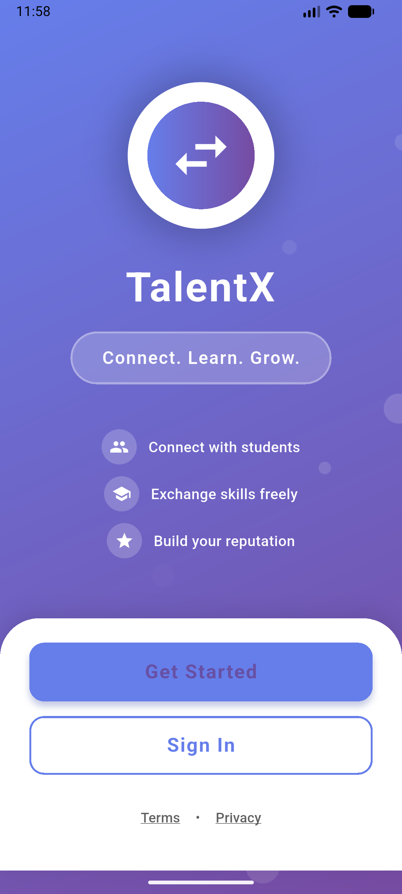
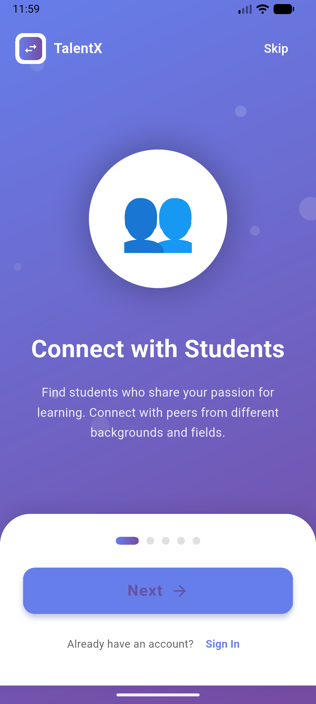
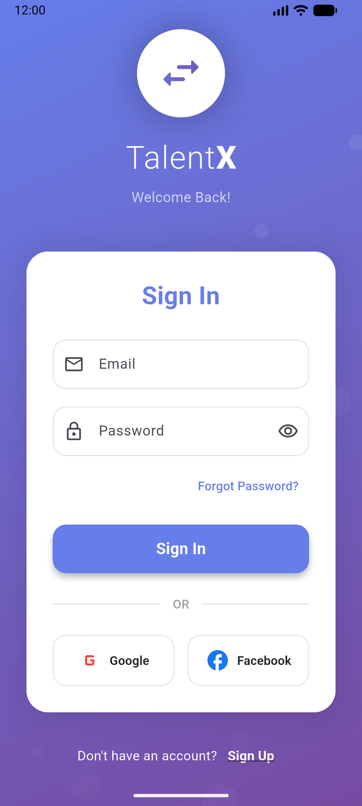
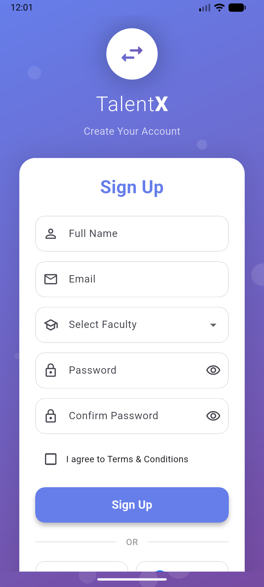
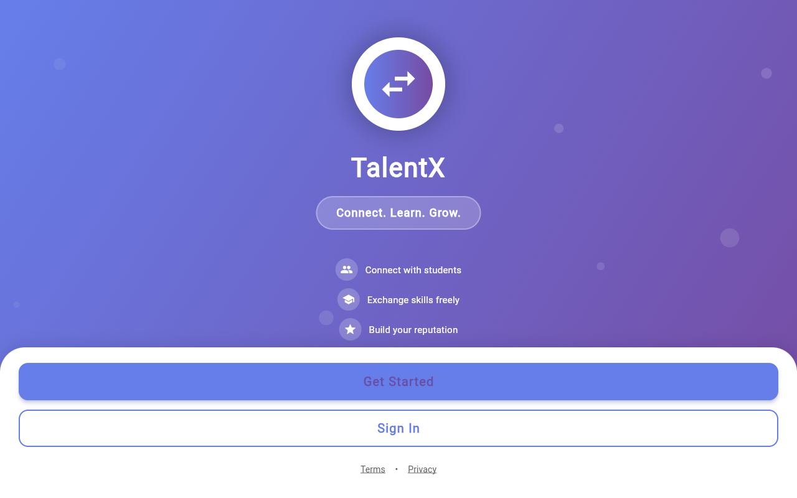

# TalentX (Talend X) — Student Skill Exchange Mobile App

A **Flutter Android mobile application** backed by **Firebase Authentication** and **Cloud Firestore** for peer-to-peer student skill exchange, real-time chat, calendar scheduling, and community discovery.

## Mobile Screenshots (Android Emulator — API 37)

| Welcome | Onboarding | Sign In | Sign Up |
|---|---|---|---|
|  |  |  |  |

## Features

- **Authentication & Onboarding:** Email/password Sign In & Sign Up, Google & Facebook sign-in integration, email verification, and multi-step onboarding.
- **Skill Exchange & Discovery:** Browse peers, filter by faculty/skills, search, favorites, and match details.
- **Real-Time Chat & Calls:** Individual chat, chat list, notifications, and video call screen.
- **Multi-Language RTL/LTR Support:** Dynamic locale switching with RTL layout support.
- **Scheduling, Wallet & Admin:** Calendar scheduling, learning progress, teaching dashboard, wallet/withdrawal screens, and admin dashboard.

## Tech Stack

- **Mobile Framework:** Flutter (`^3.9.0` Dart SDK)
- **Backend & Auth:** Firebase Core, Firebase Auth, Cloud Firestore, Google Sign-In
- **State & Localization:** Provider, `flutter_localizations`, `shared_preferences`

## Local Android Setup

```bash
flutter pub get
flutter build apk --release
flutter run
```

> **Note:** Configure your own `android/app/google-services.json` and Firebase project before running in your environment. Never commit private Firebase Admin SDK keys or release keystores.

## Android APK Download

- **Release Page:** https://github.com/Domaduios/talend-x/releases/tag/v1.0.1
- **Direct APK:** https://github.com/Domaduios/talend-x/releases/download/v1.0.1/talend-x-v1.0.1.apk


## Flutter Web Demo

- **Web Demo:** https://talend-x-web.vercel.app




